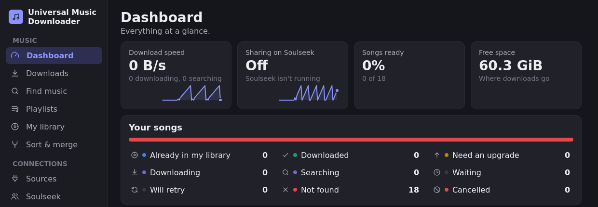
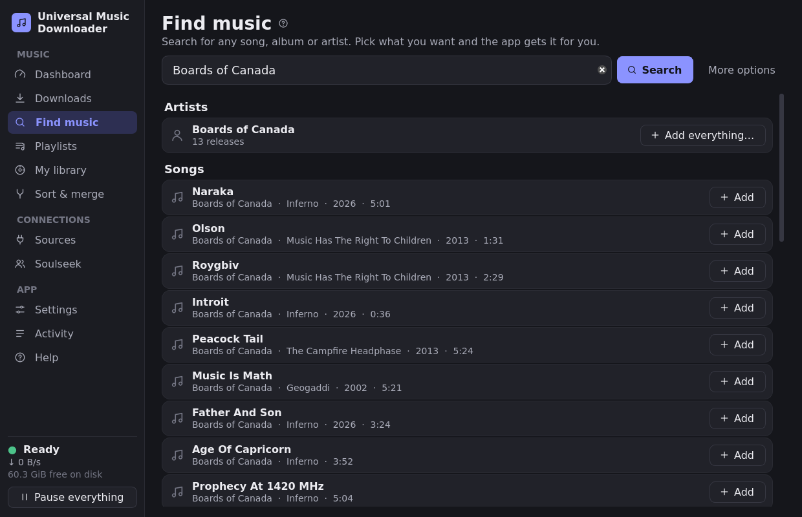
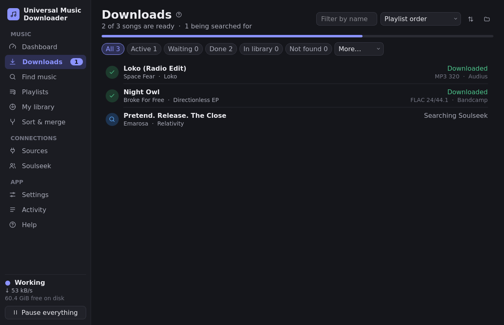
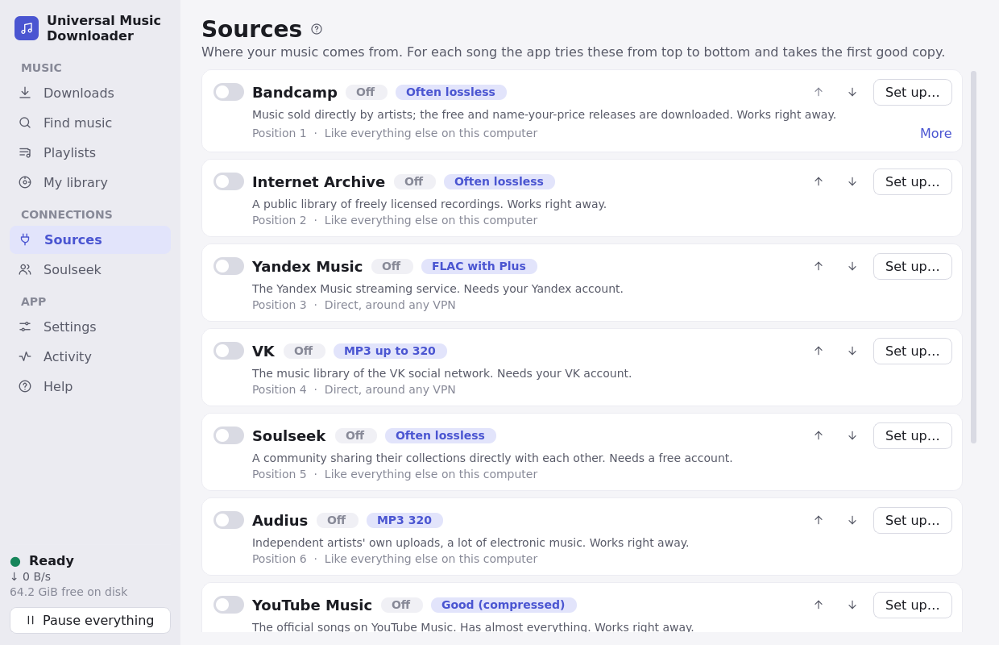
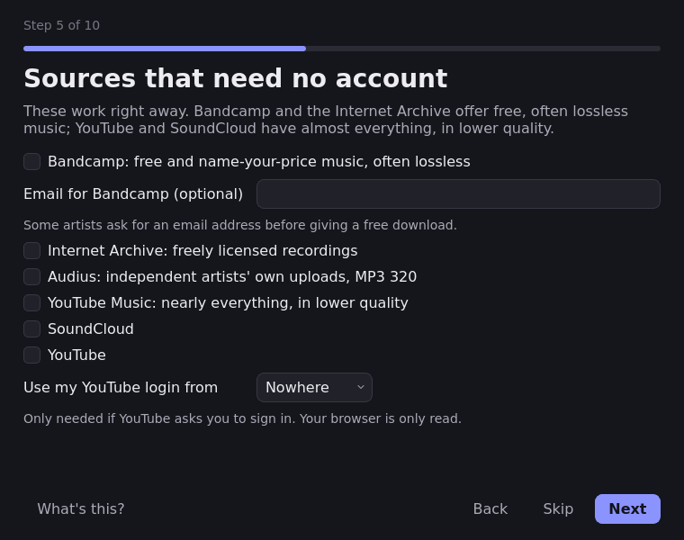

# The window, a quick tour

Everything in the app lives in the sidebar on the left. You can get by with the first two
items; the rest are there when you want them.

## At a glance

**Dashboard** is where the app opens: how fast things are downloading and being shared, how far
your songs have come, and what's taking up the disk. Click a row under **Your songs** to see those
songs in Downloads.

## Finding music

**Find music** takes a song, an album or an artist. Results come in sections; **Add** puts a
song in your downloads, **Add album** all its tracks, and **Add everything…** an artist's whole
catalog, each song once. **More options** lets you search by artist, album, song or year
separately.

## Your playlists

**Playlists** works through whole playlists at once. From Spotify: export them at
[exportify.net](https://exportify.net) and press **Add a file**. A public playlist link works
too (its first 100 songs), and so does a text file with one song, album or artist per line.
Turn a playlist off to take its songs out of the line; **Higher priority** moves it forward.

## Watching downloads

**Downloads** shows everything, with a filter for each state. Click a song to see its details
on the right: where it came from, its quality, and, if it wasn't found, what each source said.
From there you can move it to the front (**Do next**), try it again, or cancel it. **Try again**
above the list has another go at every song that wasn't found. Select several songs with Shift or
Ctrl and a click (Ctrl+A for all shown) to do any of these to all of them at once.

A song that isn't found may be listed elsewhere under another name: the artist in another
alphabet ("Alyans" is "Альянс"), the real artist instead of "Various Artists", the words in
brackets as the artist. **Find under other names…** suggests such names and takes your own; the
file found is still saved and tagged with the song's own names.

When several songs of an album are to be downloaded, the album is looked for first, once for all
of them; only the songs it doesn't have are searched for one by one. A song added as a YouTube,
SoundCloud or Bandcamp link is downloaded from that link, and that site isn't searched for it.

You can close the app at any time. It remembers where it stopped.

## What you already have

**My library** is the list of folders where you keep music, so it isn't downloaded twice. They
are only read; the one exception is Sort & merge, when you press Apply.
**What counts as good enough** decides whether a copy you have is fine, or whether a clearly
better one should be fetched. **Upgrade my library** goes looking for better copies of your
lower-quality files; they go to your downloads folder, and your originals stay.

## Tidying up

**Sort & merge** turns your library and downloads into one tidy library: every song in
Artist / Album / 01 - Song, and worse copies of songs you have moved to a folder of their own. It
takes three steps. **Make a plan** only reads your files. You then see every file's old and new
place, and every duplicate with the reason. **Apply this plan** is the only step that moves
anything. Nothing is deleted, and **Undo** puts everything back, even after restarting the app.

## Where music comes from

**Sources** are the services the app downloads from. For each song it tries them from top to
bottom and takes the first good copy, so the arrows are how you say what you prefer. The switch
turns one off, and **Set up…** shows what it needs: most need nothing at all.

## Soulseek

Soulseek is a community where people share their music directly with each other, often in
lossless quality. It takes a free account (pick a new name and password in **Set up…**), and
you share your music in return. The **Soulseek** page lets you search by hand, watch transfers,
browse what people share, keep a list of people, chat, and discover music through shared
interests.

The app searches gently and asks for only a few files at a time, because the network bans
clients that flood it. Closed "port"? **Connection → Check my connection** tells you, and
[this guide](soulseek-port-forwarding.md) explains how to open it.

## Making it yours

**Settings** has the theme (light, dark, or matching your desktop), where files go and how
they're named, the speed limit, and whether to stay in the system tray when you close the
window. Changes save as you make them.

| Keys | |
|---|---|
| Ctrl+1 … Ctrl+9, Ctrl+0 | go to a page |
| Ctrl+F | find music |
| Shift+P | pause or resume everything |
| F1 | help |
| Ctrl+Q | quit |

## First start

The first time you open the app, a short setup asks where downloads should go, whether you
already have music, and which sources you'd like. Skip anything; everything can be changed later,
and **Settings → Run the first-time setup again** brings it back.
